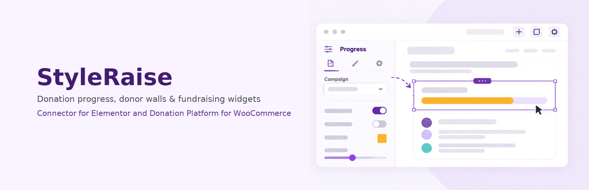

# StyleRaise – Connector for Elementor and Donation Platform for WooCommerce

Donation progress, donor walls and campaign dynamic tags for Donation Platform for WooCommerce — fully styleable inside Elementor.

An add-on for [Donation Platform for WooCommerce](https://wordpress.org/plugins/wc-donation-platform/)
(WCDP) that turns its donation progress bars, donor walls and campaign figures
into real Elementor widgets and dynamic tags, with a Style tab as complete as
any first-party widget. WCDP stays in charge of the money; this plugin takes
over the presentation.

Built by the [Ridni Foundation](https://ridni.org.ua/en/), a Ukrainian charity, and used
on its own fundraising pages.

| | |
|---|---|
| Version | 3.1.7 |
| Requires | WordPress 7.1+, PHP 7.4+, WooCommerce, Elementor 3.20+, Donation Platform for WooCommerce 1.3.2+ |
| Tested up to | WordPress 7.1 |
| License | [GPL-2.0-or-later](LICENSE) |

## Why

The donation platform prints its own markup with its own inline CSS, so every
campaign page ends up carrying a block of hand-written overrides:

- the progress bar CSS is printed inline once per page, so a second bar of the
  same style cannot be styled separately;
- the colour palette is global — one set of colours for the whole site;
- the layout relies on floats and negative margins, which collapse inside
  Elementor flex containers and loop cards;
- sizes are fixed in `em`, with no responsive controls.

This add-on replaces that presentation layer. Widgets are flexbox throughout,
every rule is scoped to the widget instance, colours and typography follow your
Elementor Global Colors and Global Fonts, and nothing uses `!important`.

## What you get

**Widgets**

| Widget | What it shows |
|---|---|
| Donation Progress | The bar plus raised, goal, percentage, still needed, deadline and donation count. Ten presets, or compose your own from toggles and text templates such as `Raised {raised} of {goal}`. |
| Donation Form | The WCDP form with a full Style tab: palette, step header, amount buttons with hover and selected states, inputs, checkout fields, popup, fee-recovery box. |
| Donor Wall | Timeline or compact list, with separate controls for every value in a donor line. |
| Donation Counter | The number renders in its own element, so it can be a badge. |
| Campaign Title, Price, Image | For campaigns that are not the current post. |

**Dynamic tags** (group "WCDP Donation"): Amount Raised · Fundraising Goal ·
Amount Still Needed · Percentage Raised · Donation Count · Campaign Deadline ·
Product ID. Drop "still needed: €12,400" into a plain Elementor Heading and
style it with Elementor's own typography controls.

**Campaign source**: pick a campaign, use the current post or loop item (each
Loop Grid card shows its own campaign), take the ID from a dynamic tag, or read
it from a post meta field.

**Fresh figures on cached pages.** A page cache stores the amount raised at the
moment it saved the page, and a donation never updates a post, so cached pages
can show an old total for hours. A 6 KB script refreshes the figures from a
read-only REST endpoint, and a donation purges exactly the cached pages that
show the campaign. Supported caches: WP Rocket, LiteSpeed Cache, W3 Total
Cache, WP Super Cache, Cache Enabler, SG Optimizer, Nginx Helper, Hummingbird,
Breeze, WP Engine, Kinsta, and anything listening to `clean_post_cache()`,
including the Cloudflare plugin. Freshness presets live under
**Elementor → WCDP Integration**.

**A donation form that does not wait for a mouse move.** "Delay JavaScript"
features hold back the donation platform's form script, so the form sits behind
a spinner until the visitor interacts. The plugin excludes that script,
together with jQuery, only on pages that show a form — in WP Rocket, LiteSpeed
Cache, Perfmatters and Autoptimize — and can mark the tags for Cloudflare
Rocket Loader, WP Meteor, NitroPack and SG Optimizer.

Also works with Polylang and WPML (optionally combining donations across
translations) and with multi-currency switchers: amounts are taken after every
filter on the site has run, so a converted amount stays converted.

## Screenshots

On the Style tab of the same preset, only the sections for the elements it shows appear: Progress Bar, Amount, Deadline and Layout.

In "Build it myself" mode, element toggles and text templates such as "Raised {raised}" and "of {goal}" build a custom layout: amounts above the bar, 74% inside it, and the deadline and donation count below.

The Donor Wall's Donor Line style section, with typography, colour, alignment and margin controls and an Individual Values list for each part of a donor line (amount, first name, last name and more).

The finished campaign page as a donor sees it: progress bar, amount still needed, donation count, recent donors and the donation form.

All screenshots are in [`.wordpress-org/`](.wordpress-org/). The demo campaign and donors are made up.

## Coming in 3.2

- **Live donation form in the Elementor editor.** Today the editor has no WooCommerce
  cart, so the donation form widget shows a notice there and the form appears only on the
  page or in Preview. Version 3.2 builds the form right in the editor canvas, so you see
  every style change live. It will be on by default, with a switch in
  Elementor → WCDP Integration to turn it off.

## Installation

1. Install and activate WooCommerce, Elementor and Donation Platform for
   WooCommerce.
2. Download `styleraise-3.1.7.zip` from the
   [latest release](https://github.com/ridni-foundation/styleraise/releases/latest) and upload it under
   **Plugins → Add New → Upload Plugin**. Use the release asset, not GitHub's
   "Download ZIP" button: the release asset unpacks into the folder WordPress
   expects.
3. In the Elementor editor, look for the **WCDP Donation** category in the
   widget panel.

Enable **WooCommerce → Analytics**: the donation platform calculates raised
totals from the analytics tables, and with analytics off every figure is wrong.
The plugin's settings screen warns you if this is the case.

A wordpress.org listing is in preparation.

## Known limitations

- The donation form is not built inside the Elementor editor: the donation
  platform needs a WooCommerce cart, which the editor usually does not have, so
  the widget shows a notice there. Open the page or Preview to see the form with
  the styles set on the widget.
- One donation form per page, and the classic `[woocommerce_checkout]` is
  required — both are limits of the donation platform.
- The donor wall and the donation form are not refreshed in the browser; page
  cache purging covers them.
- Elementor 4 atomic elements are not supported: Elementor has not published an
  API for third-party atomic elements.

## For developers

| Hook | Type | Purpose |
|---|---|---|
| `wcdp_el_widget_registry` | filter | Remove or replace a widget |
| `wcdp_el_tag_registry` | filter | Remove or add a dynamic tag |
| `wcdp_el_progress_composition` | filter | Override the progress elements before rendering |
| `wcdp_el_product_picker_limit` | filter | Number of campaigns in the editor picker (default 300) |
| `wcdp_el_freshness_config` | filter | Override the freshness policy in code |
| `wcdp_el_cache_adapters` | filter | Add support for a page cache the plugin does not know |
| `wcdp_el_api_cache_ttl` | filter | Seconds a REST response is reused on the server (default 15) |
| `wcdp_el_cache_purged` | action | Fires after page caches were purged |
| `wcdp_el_protect_form_scripts` | filter | Whether to protect the form scripts on this page |
| `wcdp_el_script_guard_patterns` | filter | Script patterns excluded on pages with a form |
| `wcdp_el_script_guard_always_patterns` | filter | Script patterns excluded on every page |
| `wcdp_el_script_guard_attributes` | filter | Opt-out attributes added to protected tags |

The REST endpoint `GET /wp-json/wcdp-el/v1/campaigns` is public and read-only.
It returns only figures already printed on the page that calls it. The plugin
makes no outbound HTTP requests and collects no telemetry.

## How this repository works

The Ridni Foundation develops its WordPress plugins in a private repository,
which also holds the foundation's site-specific configuration. This repository
is the published edition: every release here is exported from that source by
the same build that produces the wordpress.org package, and each tag has the
installable zip attached.

Issues and pull requests are welcome — see [CONTRIBUTING.md](CONTRIBUTING.md).
Accepted changes are ported to the private source and come back here with the
next release, so a merged pull request may appear as part of a release commit.
Security reports: see [SECURITY.md](SECURITY.md). Changes: [CHANGELOG.md](CHANGELOG.md).

## Support the work

The Ridni Foundation is a Ukrainian charity whose mission is to overcome
orphanhood, supporting families and children. If this plugin saves you time,
consider [a donation](https://ridni.org.ua/en/donation/?utm_source=github&utm_medium=referral&utm_campaign=styleraise&utm_content=readme-donate).

## License and trademarks

Copyright © 2026 Ridni Foundation. Released under the
[GNU General Public License v2.0 or later](LICENSE).

Elementor, WooCommerce and Donation Platform for WooCommerce are trademarks of
their respective owners. This project is not affiliated with or endorsed by
them.
